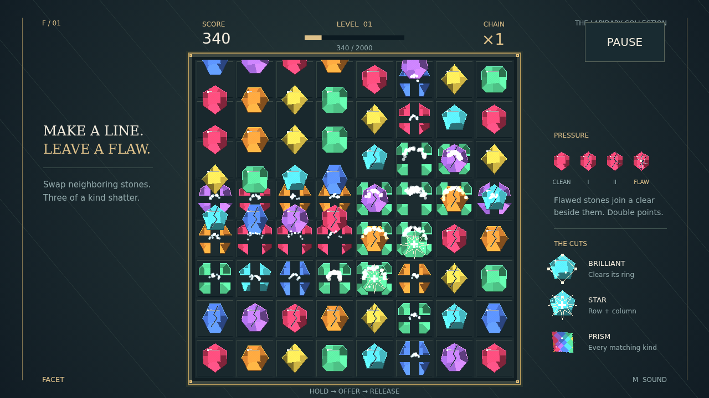

Facet is a puzzle of beautiful stones under mounting pressure. Take hold of a gem, offer it onto its neighbor, and let go. A line of three or more alike shatters, the stones above tumble down, and the next match can begin a chain.

Every clear leaves a mark. The stones beside it take strain, until their fractures run all the way through. A flawed stone joins any clear touching it and is worth double. Build pressure across the bench, then spend it in one satisfying cascade.

Long lines earn special cuts. A brilliant breaks the ring around it. A star cuts through its entire row and column. A clear, many-colored prism takes every stone of the kind you trade it against. Combine their reach with a worn corner and watch the whole position open up.

Each chain step raises the stakes and the music of breaking glass climbs with it. Fill the level meter to open a fresh bench. Play until the board has no productive move left—and see how much beauty you can break.
